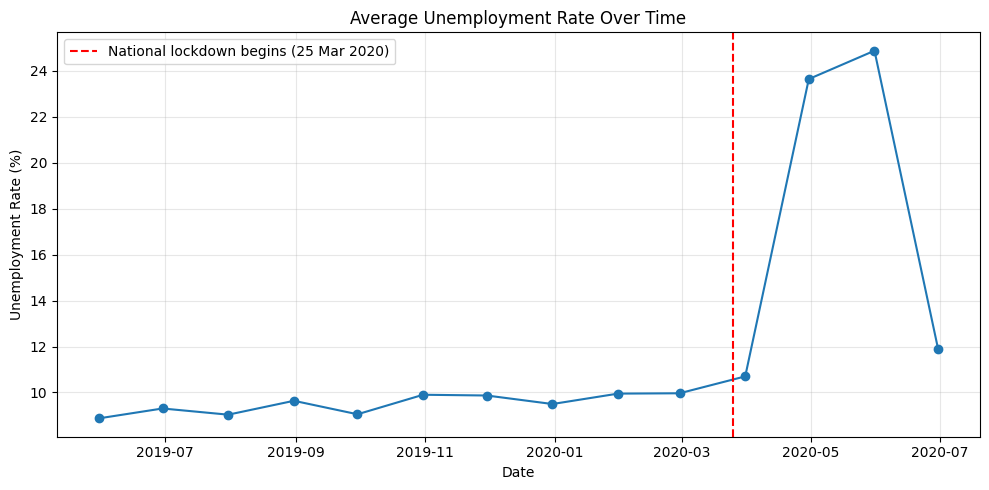
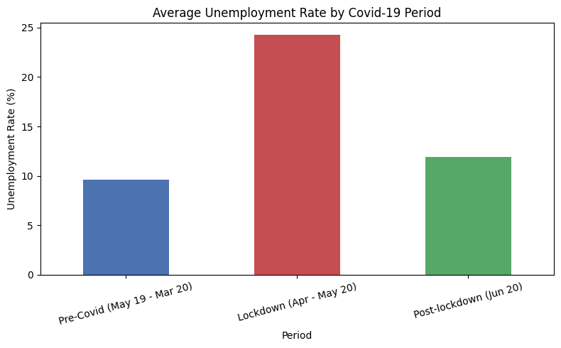
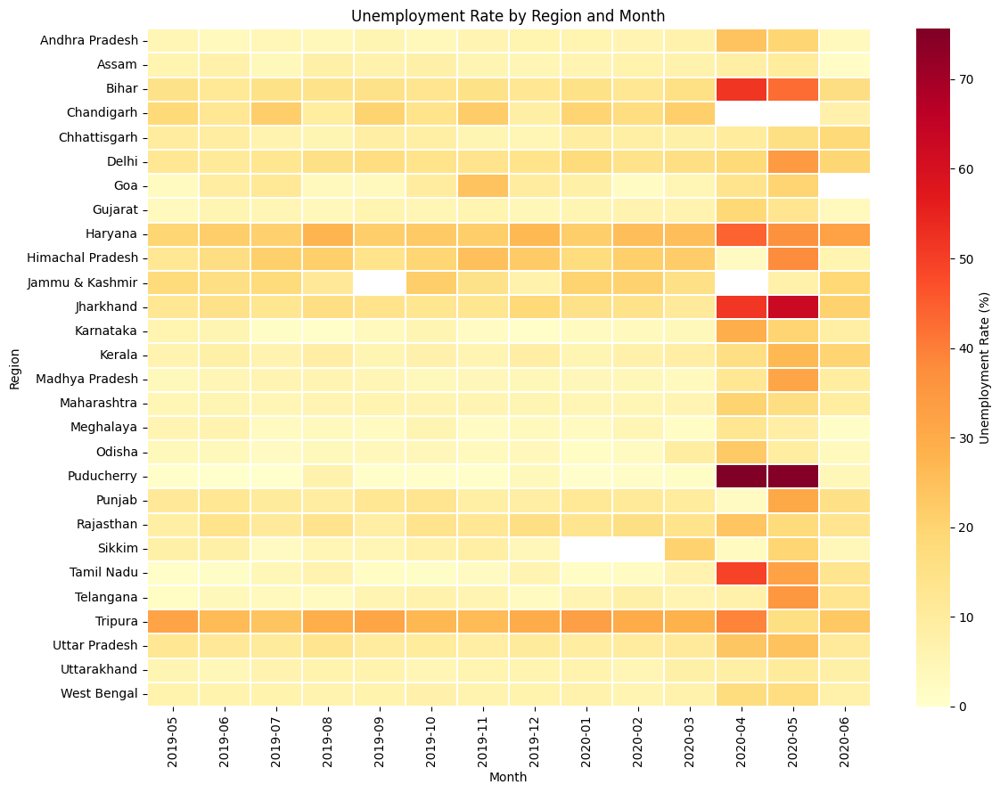

# Unemployment Analysis with Python

Analysing monthly unemployment in India from May 2019 to June 2020, measuring how the Covid-19 lockdown changed unemployment across time, regions, and rural and urban areas, and drawing out insights that could inform economic and social policy.

Completed for CodeAlpha (Data Science Internship, Task 2: Unemployment Analysis with Python).

## Overview

This project covers the full workflow: data cleaning, exploratory analysis, a before/during/after comparison of the Covid-19 lockdown, a check for seasonal trends, and policy recommendations.

## Dataset

- **Source:** Kaggle, [Unemployment in India](https://www.kaggle.com/datasets/gokulrajkmv/unemployment-in-india) (`gokulrajkmv/unemployment-in-india`)
- **Size:** 740 records after removing 28 blank rows
- **Coverage:** 28 states and regions, monthly, May 2019 to June 2020, split into rural and urban areas
- **Main columns:** Region, Date, Estimated Unemployment Rate (%), Estimated Employed, Estimated Labour Participation Rate (%), Area
- **Added during the analysis:** a `Period` column labelling each row as pre-Covid, lockdown, or post-lockdown

## Approach

1. **Data cleaning:** fixed column names, converted dates, removed blank rows, and checked for duplicates and missing values.
2. **Exploratory data analysis:** unemployment over time, highest and lowest observations, regional averages, and rural vs. urban comparison.
3. **Covid-19 impact:** labelled each month as pre-Covid (May 2019 to Mar 2020), lockdown (Apr to May 2020) or post-lockdown (Jun 2020), then compared averages by period, by region, and by rural/urban area.
4. **Visualization:** line charts with the lockdown date marked, bar charts, and a region-by-month heatmap.
5. **Seasonal trends:** examined the pre-Covid months only, so the lockdown spike would not distort the pattern.
6. **Recovery:** compared May and June 2020, and tracked the labour participation rate.

## Results

| Period | Average unemployment rate |
|---|---|
| Pre-Covid (May 2019 to Mar 2020) | 9.61% |
| Lockdown (Apr to May 2020) | 24.26% |
| Post-lockdown (Jun 2020) | 11.90% |

| Area | Pre-Covid | Lockdown | Increase |
|---|---|---|---|
| Rural | 8.23% | 21.48% | +13.25 pp |
| Urban | 10.91% | 26.93% | +16.02 pp |

## Key Insights

- **Unemployment rose about two and a half times.** It went from roughly 9.6% before the lockdown to about 24.3% in April and May 2020, then fell back to about 11.9% in June.
- **Urban areas were hit harder.** Urban unemployment rose by 16.0 percentage points versus 13.3 in rural areas, and peaked later and higher (about 28% in May 2020).
- **A few regions took the biggest hit.** Puducherry (+73.8 pp), Jharkhand (+43.2), Tamil Nadu (+37.7), Bihar (+33.3) and Karnataka (+21.2) saw the largest increases.
- **Some unemployment was already high before Covid.** Tripura has the highest overall average but is not among the biggest lockdown increases.
- **The labour market had not fully recovered by June 2020.** Labour participation fell from about 44% to 35% in April 2020 and was back to only about 40.5% by June.
- **No reliable seasonality.** Before Covid the average stayed in a narrow band of roughly 9 to 10%, and each calendar month is observed only once.

## Visuals







## Policy Recommendations

- Target emergency support at the regions with the sharpest increases.
- Design separate responses for urban and rural areas, since urban unemployment peaked higher.
- Address long-standing high unemployment (for example in Tripura) with structural job-creation policies rather than crisis relief alone.
- Prepare rapid-response measures, since unemployment more than doubled within a single month.
- Track labour participation as well as unemployment when monitoring recovery.

## Limitations

- The data covers only 14 months, so long-term recovery and seasonality cannot be assessed.
- Some region-month observations are missing (for example Chandigarh in April and May 2020), which may affect the averages.
- Averages are simple means across regions and areas, not weighted by population or labour force size.
- The analysis shows association with the early Covid-19 period, not proven causation.

## Tech Stack

Python, pandas, NumPy, Matplotlib, Seaborn, kagglehub

## How to Run

**Option 1: Google Colab (easiest).** Go to colab.research.google.com, choose **File > Open notebook > GitHub**, paste this repo's link, open the notebook, then choose Runtime > Run all.

**Option 2: On your own computer.** Click the green **Code** button on this page and choose **Download ZIP**. Unzip it, then in a terminal inside the folder run:

```bash
pip install -r requirements.txt
jupyter notebook Unemployment_Analysis_with_Python.ipynb
```

The notebook downloads the dataset automatically with `kagglehub`. If that fails on your setup, download the CSV from the Kaggle page above and update the file path in the data loading section.

## Repository Structure

```
.
├── Unemployment_Analysis_with_Python.ipynb
├── README.md
├── requirements.txt
├── unemployment_trend.png
├── covid_period_comparison.png
└── regional_heatmap.png
```

## Author

**Cherish Akhigbe**
[LinkedIn](<https://www.linkedin.com/in/akhigbe-cherish>)
